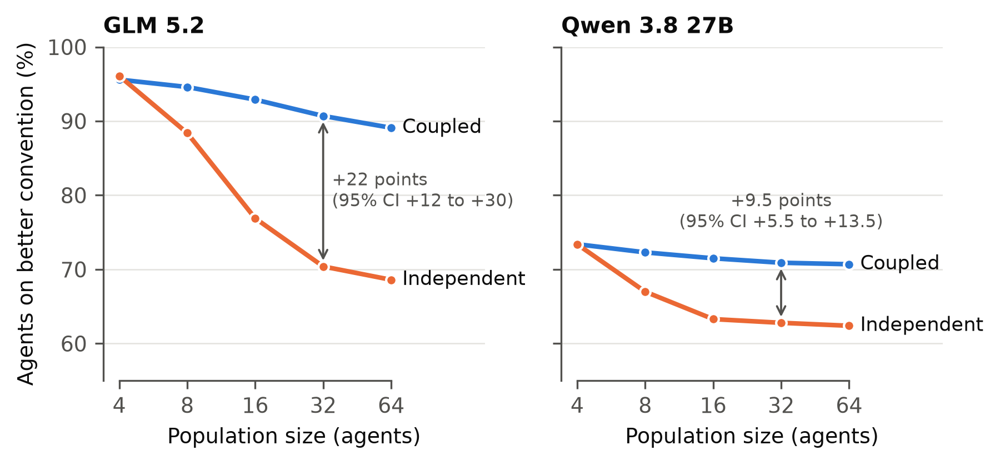
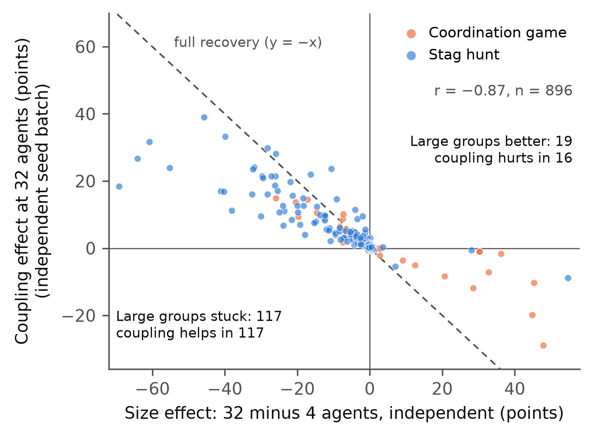

# Shared randomness makes large LLM swarms coordinate like small ones

Code and data for an Apart Research Swarm Alignment sprint project (November 2026, Track 2, with Adaption).

**Result.** Copies of the same LLM play a repeated coordination game with random partners. The game has a better convention (A) and a safer one (B). Small groups settle on A. Larger groups with the same response policy often fail to reach A and stay on it, so they miscoordinate. Coupled sampling fixes most of this without changing any agent. It shares random draws across pairs, while each agent's probabilities and each pair's joint action distribution stay exactly the same.

- **GLM 5.2, stag hunt:** 96% of agents end on A with 4 agents. With independent sampling this falls to 70% at 32 agents and 69% at 64. With coupled sampling it is 91% and 89%. The effect at 32 agents is +22.2 points (95% CI +12.0 to +30.2), worth +0.72 reward per agent per round.
- **Qwen 3.8 27B:** +9.5 points (95% CI +5.5 to +13.5).
- **Across 896 prompt and model variants:** 117 do worse at 32 agents than at 4. Coupling helps in all 117 and recovers a median 72% of the loss.
- **Coupling is not a general improvement.** Where large groups already do better, it usually hurts (16 of 19 variants). The size effect predicts the coupling effect with r = −0.87, using separate seed batches for the two.
- **Mechanism:** coupling makes A easier to reach and harder to leave. With 32 agents starting from B–B histories, 63% of independent runs reach sustained A, against 99% with coupling. Starting from A–A histories, 81% of independent runs leave A, against 24% with coupling.





## How it works

Each agent's policy is P(A | last two rounds), measured once from an LLM over 21 histories. Populations are then simulated with these frozen policies.

- **Independent sampling:** every agent draws its own random number.
- **Coupled sampling** (`pair_shared:restore`): with probability α, all first-seat agents in a round share one draw and all second-seat agents share another. α is set each round so that the variance of the population share matches a 4-agent group.

The pre-registered protocol is in [`PROTOCOL.md`](PROTOCOL.md) and the full log of results, including nulls, is in [`FINDINGS.md`](FINDINGS.md).

## Reproduce the paper's figures and checks (no API calls)

```bash
python3 -m venv .venv && .venv/bin/pip install numpy matplotlib pytest
.venv/bin/python -m pytest -q                      # sampler maths against exact reference values
.venv/bin/python -m swarm.paper_figures            # Figures 1-2 -> report/figures/
.venv/bin/python -m swarm.checks report            # seed-split and start-state summaries
.venv/bin/python -m swarm.checks seedsplit         # rerun the independent seed batch (CPU, minutes)
.venv/bin/python -m swarm.checks starts            # rerun the A-A vs B-B start test
```

Re-measuring policies from LLMs needs API keys and the full `requirements.txt`; see the full pipeline below.

## What's included

| Path | What |
|---|---|
| `swarm/` | game, prompts, policy extraction, samplers, simulation, reports, paper figures and checks |
| `policies/` | every measured policy with provenance (`adaption_v2/` for confirmations, `openrouter/grid/` for the 896-variant grid) |
| `results/explore/` | the grid: size and coupling effects for every variant |
| `results/confirm/`, `results/ext/` | confirmation sweeps and bootstraps (summaries and contrasts) |
| `results/checks/` | separate-seed recomputation and the start-state test |
| `results/live/` | live Adaption play used to validate the measured policies |
| `report/figures/`, `report/data/` | paper figures and the data behind them |
| `report/index.html` | interactive results dashboard |
| `tests/` | unit tests, including the exact reference table |

Per-run CSVs (about 180 MB) are left out. The `simulate`, `sweep` and `checks` commands regenerate them.

## Full pipeline

```bash
python3 -m venv .venv && .venv/bin/pip install -r requirements.txt
cp .env.example .env   # then paste OPENROUTER_API_KEY and ADAPTION_API_KEY
.venv/bin/python check_keys.py
```

```bash
# Exact synthetic reference table (validates the sampler maths)
.venv/bin/python -m swarm reference

# Extract a policy through Adaption. Adaption returns no token probabilities, so each of the
# 84 prompts (21 histories x 2 framings x 2 label mappings) is sampled 200 times.
.venv/bin/python -m swarm extract --backend adaption --model qwen3.8-27b --samples 200 --out policies/adaption_qwen3.8-27b.json
.venv/bin/python -m swarm show-policy policies/adaption_qwen3.8-27b.json

# Exact-probability cross-checks: OpenRouter logprobs, or a local Hugging Face model
.venv/bin/python -m swarm extract --backend openrouter --model qwen/qwen3.8-27b --out policies/screening/openrouter_qwen3.8-27b_exact.json
.venv/bin/python -m swarm compare-policies policies/adaption_qwen3.8-27b.json policies/screening/openrouter_qwen3.8-27b_exact.json -v

# Frozen-policy sweep (500 runs per cell, 100 rounds). Writes runs.csv, summary.csv, contrasts.csv, manifest.json
.venv/bin/python -m swarm simulate --policy policies/qwen3.6-35b-a3b.json --framing 0 --mapping 0 --out results/my_run
```

Extended study:

- `python -m swarm extract ... --game stag --framings 0 1 2 3 4 5 6 7 --mappings 0 1 2 3` measures the stag hunt with eight wordings and four label versions. `--backend openrouter --provider <tag>` pins one deployment.
- `python -m swarm.sweep explore`, then `python -m swarm.explore_report`, simulates and summarises every variant (`results/explore/`).
- `logs/run_confirm3.sh <policy> <out> <variants>` runs confirmation sweeps (N = 4-64, coupling strength 0.1-1) and the bootstrap.
- `python -m swarm.ext_report results/ext/<set>` summarises one set.
- `python -m swarm.retest <orig> <fresh>` is the Adaption test-retest.

Sampler specs:

- `independent`
- `pair_shared:restore` (primary)
- `pair_shared:0.3` (fixed α)
- `block:2` (equal-variance comparator with thinner tails)
- `global_shared:restore` (also changes within-pair coordination)

Seeds 0+ are confirmatory, 10000+ are calibration and 200000+ are the separate batch for the seed-split check.

The scripts in `logs/` contain absolute paths from the original machine; edit them before running.
